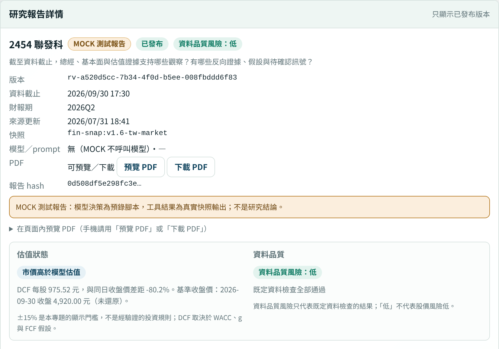

> **版本說明：** v2 草稿（2026-10-31），依 A 的 W06、W07 驗收紀錄與截圖、B 的 W07 技術事實、組長的 trace 撰寫，待 B 核對技術事實、組長核准文字。數字一律照抄成員文件。**三份線上 PDF 都是 MOCK 測試報告，不是研究結論。**

## 7.1　網站到 PDF 的版本一致性

網頁與 PDF 讀的是**同一份核准報告 JSON**。報告版本建立時，系統用 B 的工具把季度表、DCF 假設與敏感度、資料品質、2454 同業比較、價格窗與來源（含 hash 核對）先算好，凍結在報告 JSON 中；之後網頁與 PDF 都只讀這一份。PDF 程式只負責排版，**不呼叫語言模型，也不由模型另外改寫一遍**（A `reports/v12-online-pdf-check.md` 第 1、3 節）。

一份報告要成為「已發布」，必須依序通過以下步驟（A 同上第 1、5 節；組長 `handoff/state-machine-v1.md` 第 5 節）：

1. 研究 job 結束後，報告先建立為草稿版本，不公開。
2. 組長登入，帶著自己看過的報告 hash 核准；hash 不符就不發布。
3. 產生 PDF，寫入 Storage；Storage 不可覆寫。
4. 從 Storage 讀回 PDF，比對 hash；全部成功才標為 published。

同一 job 發布第 2 版後，第 1 版 PDF 仍可下載且內容不變；歷史版本只列已發布的版本。公開讀取（清單、詳情、下載）不呼叫模型（A 同上第 5 節）。

三份驗收 PDF 的版本與 hash 如下（A 同上第 2 節；`reports/v12-online-pdf/manifest.json`）：

| 股票 | 報告版本 | 報告 hash（前 16 碼） | PDF hash（前 16 碼） | 頁數 |
|---|---|---|---|---|
| 2330 | rv-d407e7cc-cf7c-4c8a-a210-9d3452d75454 | f46a0c5f35c7579e | 585953fcf537426b | 3 |
| 2317 | rv-915bb95c-9fbd-435b-8fdd-5e83188e24d7 | b8be13bc34f0ab35 | ddb9599b22859456 | 3 |
| 2454 | rv-a520d5cc-7b34-4f0d-b5ee-008fbddd6f83（2026-10-31 版） | 0d508df5e298fc3e | 7b654bb1cad33be6 | 3 |

A 以程式檢查每份 PDF：報告 JSON 中的關鍵項目（每條主張、每條限制、估值狀態、資料品質風險、免責聲明、每季營收、DCF 每股、每個來源與同業）全部出現在 PDF 文字中，hash 相符（A 同上第 3 節）。三份報告的核准，是由 A 的驗收腳本以組長身分執行（manifest 的 approved_by 欄），不是組長本人逐份審閱；組長的正式驗收尚未完成。

## 7.2　網站與本機的角色

學期初的基線版本中，公開網站因 Render 免費方案的記憶體限制略過 PDF，PDF 只能在本機產生（R08 固定版本的 PROJECT_STATUS.md）。V1.2 改為由網站提供線上 PDF：網站提供預覽、下載與已發布歷史版本；設定 Supabase 環境變數時，PDF 存入私有 bucket，金鑰只在伺服器端（A 同上第 1 節）。組長已於 2026-10-28 接上 Supabase 測試專案的資料庫與私有 Storage（A 同上第 6 節）。

本機的角色是開發與驗收：A 在本機以 MOCK 模式啟動網站，用瀏覽器模擬 1440 與 390 寬度測試清單、詳情、預覽與下載（A 同上第 4 節）。

**仍待完成**：正式部署到 Render 屬於 W08；手機只做過桌面瀏覽器模擬，尚未實機測試；研究入口目前只開 MOCK，何時開放 LIVE 由組長決定（A 同上第 4、6 節）。因此本稿不宣稱線上 PDF 已在正式網站上線。

## 7.3　收藏儀表板

收藏儀表板讓使用者在瀏覽器中收藏最多 5 個代號，只存代號、不跨裝置；畫面列出已發布研究，顯示版本、資料截止、財報期、來源更新時間、估值狀態與資料品質風險。A 的驗收以無介面瀏覽器依序切換 5 檔股票、收藏、篩選與排序、開啟三份報告，全程只發出讀取請求，沒有建立 job、沒有寫入資料庫，模型呼叫 0 次（A `ui/v12-dashboard-acceptance.md` 第 2、4 節）。

{width=38%}

資料品質風險沒有執行任何檢查時顯示「未評估」，不顯示為低風險；每張卡片固定註明「低」不代表股價安全（A 同上第 4 節）。

## 7.4　線上報告與 PDF

報告詳情頁與 PDF 包含研究問題與 cutoff、主張（事實、推論、未知）、反向證據、季度資料、2454 同業比較、DCF 與敏感度、資料品質風險、未知事項、來源，以及版本與方法限制（A 同上第 3 節）。2317 的估值顯示「無法判定：TTM FCF ≤ 0，5 年持平情境不適用」，不出現負的 DCF（同上）。

{width=80%}

來源欄位區分兩種：公告片段，以及財報快照的工具結果；後者標示「工具結果，不是公告片段」，並列出可得時間、原始財報檔編號與 sha256（A 同上第 0 節）。

## 7.5　三個短案例

**案例一：正常（MOCK）。** 2454 的研究報告走完建立草稿、核准 hash、產生 PDF、寫入 Storage、讀回比對 hash 的完整流程，成為已發布版本 rv-a520d5cc。這份報告是 **MOCK**：模型的決策是預錄腳本（先 revise、後 pass），工具結果則是 B 快照的真實輸出；PDF 首頁標示「MOCK 測試報告：不是研究結論」。附件：`reports/v12-online-pdf/` 內的 PDF、報告 JSON 與 manifest（A）。

**案例二：衝突（live，dual 模式，新規則）。** CASE-08 是開發案例，類別「矛盾來源」，題型為同一事件兩個來源金額不同，標的 2317。Researcher 搜尋證據後，讀了官方損益表（ev-dev-08-official）與一份二手整理摘要（ev-dev-08-conflict）（#4、#6、#7），撰寫草稿（#11）。Reviewer 讀兩份證據核對（#13、#14），模型判 pass，規則判 revise（critical 指向 c2），最終取較嚴格的 revise，退回 Researcher（#16；摘要檔只保存最後一次覆核內容，第一次退件的完整理由沒有保存）。Researcher 修正一次（#17、#18）：以官方損益表的營業收入作為事實主張，把二手摘要的數字改標為 unknown，並在 conflicts 欄記錄兩個來源有落差、無法在原文中核實，回報 insufficient。規則檢查（#19）沒有 critical，job 以 insufficient_evidence 結束，未發布。整個 job 用了 6 次模型發送、5 次工具呼叫、1 輪補查。附件：live trace job d8884abc-b06f-4568-802d-83992bc82ad3（組長 `agent/calib-v1-dual-rerun-1.json`；步驟序號以 # 表示）。

**案例三：不足（live，dual 模式，修正前規則）。** CASE-18 是開發案例，類別「缺少資料」，題型為關鍵證據在 cutoff 之後，標的 2454。Researcher 搜尋證據時查無資料（#4，no_data），只取得 2026Q1 的財務快照（#6）。第一次撰寫的草稿沒有通過程式的草稿格式檢查（#9，trace 記為 draft_invalid；摘要檔沒有保存檢查出的問題內容），系統要求重寫，用掉第 4 次模型發送後，Researcher 交出狀態為 insufficient 的草稿（#11）：唯一的主張標為 unknown，沒有任何事實數字。這份草稿本身也有問題。確定性規則檢查（#12）判 insufficient，列出兩個 critical：一是主張 c1 引用的工具結果 obs-1 是 search_evidence 的 no_data，不是有效資料；二是草稿沒有任何有來源的事實主張，沒有可核對的內容。job 以 insufficient_evidence 結束，未發布。這次執行沒有補造 2026Q2 的數字，但它不是模範結果：草稿先是格式不合格，交出的版本又引用了無效的工具結果。整個 job 用了 4 次模型發送、2 次工具呼叫。附件：live trace job 6f344c33-1ecf-47e6-92e8-6d0aa14ec1cc（組長 `agent/calib-v1-day4.json`；步驟序號以 # 表示）。這次是修正前規則的執行；新規則重跑（job de1d50cf，組長 `agent/calib-v1-dual-rerun-1.json`）同樣停在證據不足。

**說明**：在 10/31 修正前的規則下（校準第 1–4 天），dual 模式尚無一案通過覆核（組長 `handoff/W06-gate-v12.md` 第 8 節；`agent/calib-v1-day1~4.json`）。10/31 修正規則後，以新規則執行的開發集 10 案 dual 中，**4 案通過覆核**（CASE-01、11、22、26），其餘 6 案停在證據不足（組長 `agent/calib-v1-day5.json`、`agent/calib-v1-dual-rerun-1.json`、`-2.json`）。「通過覆核」只表示模型與確定性規則都沒有找到 critical 問題，**不代表內容正確**；正確性要等 D 評分，本節不寫正確率或成功率。CASE-11 兩次執行都照實記錄：修正前（job da86df90，10/29）證據可得時間 14:15 其實早於 cutoff 17:00（台北），Reviewer 模型自行比較時區出錯而判 insufficient，規則判 pass，最終取較嚴格的 insufficient，是誤擋；組長 10/31 改由程式比對可得時間後重跑（job 9fc9e029），模型與規則都判 pass，通過覆核（組長 `agent/calib-v1-day2.json`、`agent/calib-v1-dual-rerun-1.json`；decisions 第 9 節）。研究 job 本身不發布，以上 job 都沒有進入發布流程，所以「正常」案例仍以 MOCK 報告示範發布流程，不能當作研究結果。三個案例都是開發案例或驗收用報告，不是保留案例，也不是正式實驗結果。

## 7.6　live、mock 與 replay

| 類型 | 意思 | 本節用到的例子 |
|---|---|---|
| live | 真實模型（gemini-3.5-flash-lite）每一步自己決定 | 衝突、不足兩例 |
| mock | 模型回覆為預錄腳本，工具與快照是真的；報告首頁標示 MOCK | 正常一例、三份線上 PDF |
| replay | 重播已保存的紀錄，不重新呼叫模型 | 本節未使用；正式定義待 D |

（組長 `agent/*.json` 的 note；A `reports/v12-online-pdf-check.md` 第 2 節。）

## 7.7　待補

已完成：A 已於 2026-11-02 提供現行版本截圖（圖 7-1、7-2 已更換）；B 已以 10/29、10/31 新版報告重跑稽核，`data/v12-report-audit.csv` 的 W7A-001～039 共 39 項全部 pass（B `docs/B-review-W02-W07-C.md` 第一節）。

| 缺什麼 | 提供人 |
|---|---|
| 正式部署後的網站與手機實測 | 組長（W08） |
| LIVE 報告 | 組長決定開放時機 |
